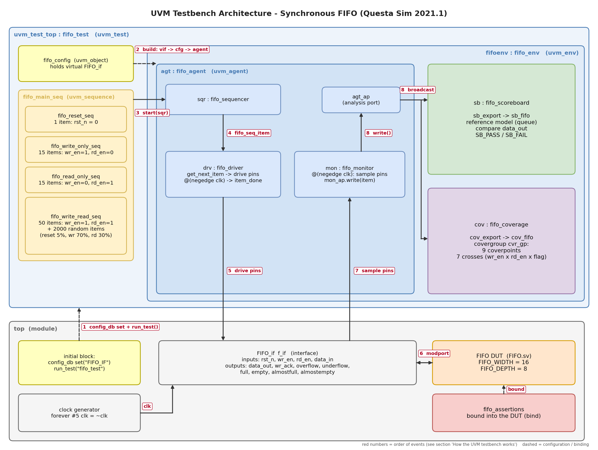

# UVM FIFO Project

Full UVM verification environment for a synchronous FIFO (16-bit data, depth 8), built on the FIFO of the earlier SystemVerilog project.
Simulator: **QuestaSim 2021.1**.



## Repository structure

```
UVM_FIFO_Project/
├── code/                          everything needed to run the simulation
│   ├── run.do                     step 1: compile + simulate
│   ├── save_cov.do                step 2: save coverage + write the 3 reports
│   ├── src_files.list             compile order of all files
│   ├── FIFO.sv, fifo_if.sv        design and interface
│   ├── top.sv                     top module (clock, interface, DUT, bind, run_test)
│   ├── fifo_assertions.sv         assertions + cover directives (bound into the DUT)
│   └── fifo_*.sv                  UVM classes, one class per file and package
└── docs/                          documentation
    ├── FIFO_UVM_Verification_Plan.xlsx
    ├── UVM_FIFO_Testbench.drawio  editable diagram (draw.io)
    ├── UVM_FIFO_Testbench.png
    ├── <project report>.pdf       full project report
    └── coverage_reports/          code, functional and sequential domain coverage reports
```

## How to run (QuestaSim)

1. Open QuestaSim and use **File > Change Directory** to select the `code` folder.
2. In the transcript type `do run.do`. It compiles `src_files.list`, simulates and runs until UVM calls `$finish` (about 20,810 ns); the waveform stays open.
3. Type `do save_cov.do`. It saves `fifo_tb.ucdb` and `fifo_code.ucdb`, closes the simulation and writes `code_coverage_rpt.txt`, `functional_coverage_rpt.txt` and `assertion_coverage_rpt.txt` into `code/`.

The generated files are ignored by git; copy the final reports to `docs/coverage_reports/` when you want to keep them.

## UVM testbench

| Component | File | Role |
|---|---|---|
| Test / environment | `fifo_test.sv`, `fifo_env.sv` | build and connect, start the sequences |
| Agent | `fifo_agent.sv`, `fifo_sequencer.sv`, `fifo_driver.sv`, `fifo_monitor.sv` | drive the interface and sample it |
| Sequence item | `fifo_seq_item.sv` | randomized inputs with constraints (reset 5%, write 70%, read 30%) |
| Sequences | `fifo_reset_seq`, `fifo_write_only_seq`, `fifo_read_only_seq`, `fifo_write_read_seq`, `fifo_main_seq` | directed and random stimulus |
| Scoreboard | `fifo_scoreboard.sv` | reference queue model, checks `data_out` |
| Coverage | `fifo_coverage.sv` | covergroup: 9 coverpoints and 7 crosses |
| Assertions | `fifo_assertions.sv` | 18 assertions, 13 cover directives, bound with `bind FIFO ...` in `top.sv` |

## Results

| Report | Result |
|---|---|
| Functional coverage | **100.00%** (66 / 66 bins; 8 impossible bins excluded with `ignore_bins`, justified in the report) |
| Sequential domain coverage | **18 / 18 assertions** pass with 0 failures, **13 / 13 cover directives** covered |
| Code coverage (FIFO.sv) | Statement 100%, Branch 100%, Toggle 100%, Condition 90% (2 condition rows are unreachable by construction), total 98.33% |

Bugs found in the original RTL and how the environment detects them are described in the report (Bug Report section).

## Requirements checklist

| Requirement | Where |
|---|---|
| Full UVM environment | `code/` |
| Constraints in the sequence item | `code/fifo_seq_item.sv` |
| Covergroups in the coverage collector | `code/fifo_coverage.sv` |
| Assertions bound in the top module | `code/fifo_assertions.sv`, `code/top.sv` |
| Main sequence split into several sequences | `code/fifo_*_seq.sv` |
| Verification plan | `docs/FIFO_UVM_Verification_Plan.xlsx` |
| UVM diagram | `docs/UVM_FIFO_Testbench.drawio` and `.png` |
| Code, functional and sequential coverage reports | `docs/coverage_reports/` |
| Bug report, waveform snippets, description of how the testbench works | project report in `docs/` |
| Do files | `code/run.do`, `code/save_cov.do` |

## Author

Ahmed Wael Sadek El Sawy
